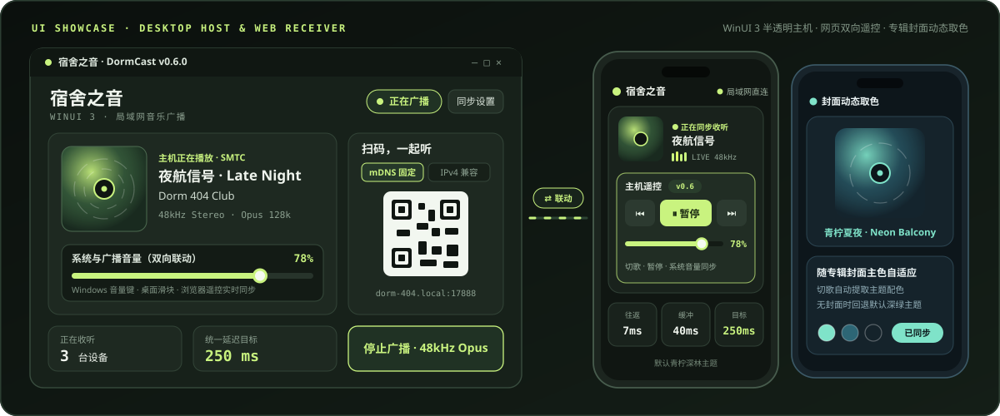
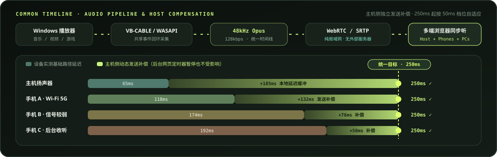

  <a href="README.md">简体中文</a> · <strong>English</strong>

  

  
  
  
  

  <a href="https://github.com/DrivingGodJ/DormCast/releases/latest"><strong>⬇️ Download Windows Installer</strong></a>
  &nbsp;·&nbsp;
  <a href="docs/GUIDE.en.md"><strong>📖 User Guide</strong></a>
  &nbsp;·&nbsp;
  <a href="docs/architecture.md"><strong>⚙️ Architecture (ZH)</strong></a>
  &nbsp;·&nbsp;
  <a href="docs/TESTING.md"><strong>🧪 Testing &amp; Limits</strong></a>

---

> **Why DormCast?** One night our dorm wanted to listen to music together—setting up speakers was a hassle, and wearing separate headphones felt isolating. So we built DormCast to broadcast live Windows system audio across the local network, turning everyone's phones, tablets, and laptops into one synchronized speaker through an ordinary browser.

**No accounts · No receiver app installation · Local LAN only · No external audio servers.**

---

## Interface & Live Sync Preview

  

---

## Key Features

<table>
  <tr>
    <td width="50%" valign="top">
      <h3>🔊 Broadcast All Windows System Audio</h3>
      
Captures live Windows audio loopback—music, videos, games, or browser tabs. The native <strong>WinUI 3</strong> translucent host shows album art, artist, and title via SMTC, and keeps broadcasting from the system tray when closed.

    </td>
    <td width="50%" valign="top">
      <h3>📱 Scan to Join · Dual Entry Points</h3>
      
Listeners scan a QR code or bookmark a persistent <code>.local</code> mDNS join link—no app or sign-in needed. Switch URL and QR display to <strong>IPv4 compatibility</strong> for devices (such as some Huawei phones) that cannot resolve mDNS; both entry points stay active simultaneously.

    </td>
  </tr>
  <tr>
    <td width="50%" valign="top">
      <h3>🎛️ Host &amp; Browser Remote Control (v0.6)</h3>
      
In virtual-cable synced mode, Windows volume keys, the desktop slider, and the browser remote panel stay bi-directionally synced—controlling <strong>play/pause, previous/next track, mute, and shared host/broadcast volume</strong> (can be toggled in Sync Settings). Each phone still controls its own hardware volume.

    </td>
    <td width="50%" valign="top">
      <h3>🎨 Cover-Adaptive Web Theme &amp; Native Polish</h3>
      
The desktop window follows Windows light/dark theme and accent color; the web receiver <strong>dynamically adapts its theme palette to the current album cover's dominant color</strong> (falling back to the default forest-lime theme when no artwork is available). Includes iOS home-screen icon, silent background startup update checks (notifying only when a newer release exists), and manual SHA-256 verified GitHub updates.

    </td>
  </tr>
  <tr>
    <td width="50%" valign="top">
      <h3>⏱️ Steadier Shared Timeline</h3>
      
Streams <strong>48kHz stereo Opus over WebRTC</strong>. The common delay target starts at <code>250ms</code>, adjusts in <code>50ms</code> steps after observation, and automatically reduces after 60 seconds of stability. Send compensation runs on the host even when mobile browsers throttle background timers.

    </td>
    <td width="50%" valign="top">
      <h3>📊 Per-Device Real-Time Diagnostics</h3>
      
Expand device diagnostics on the host to inspect base-path latency, current and planned compensation, estimated alignment error, RTT, jitter, buffering, packet loss, and measurement freshness per listener.

    </td>
  </tr>
</table>

---

## Audio Pipeline & Shared Timeline

  

> [!NOTE]
> **Known Boundaries**: Delay targets and alignment errors are software estimates; acoustic verification across multiple physical devices is still outstanding. Browser and iOS power policies may suspend background tabs, and Bluetooth output can add unreported hardware delay (configurable per-device as an extra hardware offset in the web details drawer).

---

## Quick Start

1. **Install the latest Release (with automatic VB-CABLE setup)**
   Download `DormCast-x.y.z-Setup-x64.exe` from [Releases](https://github.com/DrivingGodJ/DormCast/releases/latest) (**Windows 10 22H2 / Windows 11 x64**; self-contained with .NET and WinUI runtimes included). Setup detects whether **VB-CABLE** is already installed: if absent, it requires installing the virtual driver; if already present, it skips driver installation automatically. Uninstalling DormCast also uninstalls VB-CABLE.
2. **Pick your physical output device (virtual cable auto-selected)**
   Open DormCast and simply select your physical speakers or headphones; the virtual audio cable is selected automatically. If no virtual cable is detected, broadcasting is blocked and an installation guide is shown.
3. **Start broadcasting & scan to listen**
   Click **Start Broadcast**. Connect other devices to the same Wi-Fi, scan the QR code, and tap Listen if browser autoplay is blocked.

<strong>📌 Persistent Join Identity &amp; LAN Security Boundaries</strong>

- **Persistent Identity**: Each host derives a stable `.local` hostname and random 256-bit join key, backed up in both `%LOCALAPPDATA%/DormCast/join-identity.json` and `HKCU/Software/DrivingGodJ/DormCast/Identity`. Normal reinstallation or clearing app data preserves the link; reinstalling Windows, changing users, or removing both records generates a new join link.
- **IPv4 Fallback**: Networks or devices that do not support `.local` mDNS resolution can switch the host display to **IPv4 Compatibility** without disconnecting existing listeners.
- **Strict LAN Scope**: Binds only to the selected private IPv4 interface with same-subnet filtering, disables external STUN/TURN, encrypts WebRTC audio with DTLS-SRTP, and never uploads audio to external servers (internet access occurs only for the silent startup update check or when manually checking GitHub Releases).

---

## Documentation & Source

| Document | Overview |
| :--- | :--- |
| [User &amp; Developer Guide](docs/GUIDE.en.md) | Driver setup, linked volume, background playback, firewall rules, updates, and local builds |
| [Technical Architecture (Chinese)](docs/architecture.md) | WASAPI Loopback, Opus encoding, HostMonitor, shared timeline math, and network boundaries |
| [Test Results &amp; Limits](docs/TESTING.md) | Automated checks, observed measurements, and hardware caveats |
| [Acoustic Measurement Procedure (Chinese)](docs/measurement.md) | Cross-device physical acoustic latency verification protocol |
| [Reference Projects (Chinese)](docs/reference-projects.md) · [Third-Party Notices](THIRD-PARTY-NOTICES.md) | Upstream libraries, regional license terms, and driver notices |

---

## License

DormCast's own code is released under the [MIT License](LICENSE). Third-party dependencies and the bundled driver retain their respective licenses—note that SIPSorcery's license includes additional geographic restrictions, and the unchanged official VB-CABLE package must be installed manually by the user. See [THIRD-PARTY-NOTICES.md](THIRD-PARTY-NOTICES.md).
