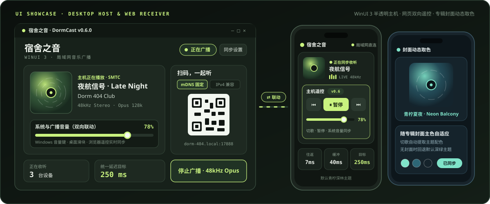
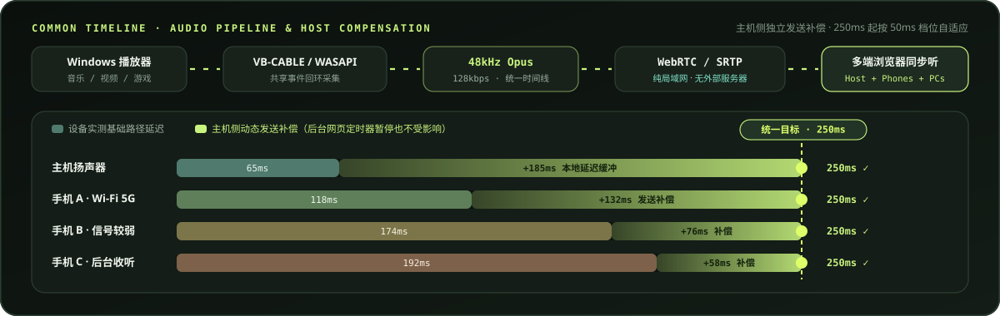

  <strong>简体中文</strong> · <a href="README.en.md">English</a>

  

  
  
  
  

  <a href="https://github.com/DrivingGodJ/DormCast/releases/latest"><strong>⬇️ 下载 Windows 安装包</strong></a>
  &nbsp;·&nbsp;
  <a href="docs/GUIDE.zh-CN.md"><strong>📖 使用指南</strong></a>
  &nbsp;·&nbsp;
  <a href="docs/architecture.md"><strong>⚙️ 技术架构</strong></a>
  &nbsp;·&nbsp;
  <a href="docs/TESTING.md"><strong>🧪 测试与边界</strong></a>

---

> **项目的由来**：那天寝室想一起听歌，但搬音响太麻烦、各戴耳机又太孤单——干脆把 Windows 正在播放的系统声音实时广播到同一局域网，让手机、平板、电脑打开浏览器，连成一台同步音响。

**无需账号 · 无需安装接收端 App · 声音留在局域网 · 无外部音频服务器。**

---

## 界面与联动一览

  

---

## 核心特性

<table>
  <tr>
    <td width="50%" valign="top">
      <h3>🔊 共享电脑的所有声音</h3>
      
捕获 Windows 系统音频回环，音乐、视频、游戏、网页统统一键开播；主机采用原生 <strong>WinUI 3</strong> 半透明窗口，显示播放器提供的封面、歌手与专辑，关闭窗口后缩到系统托盘继续广播。

    </td>
    <td width="50%" valign="top">
      <h3>📱 扫码即听 · 双入口常驻</h3>
      
同一局域网下打开浏览器即可收听，支持收藏每台主机专属的 <code>.local</code> 固定链接；遇到不支持 mDNS 的设备（如部分华为手机），可一键切换 <strong>IPv4 兼容</strong> 网址与二维码，两种入口始终同时生效。

    </td>
  </tr>
  <tr>
    <td width="50%" valign="top">
      <h3>🎛️ 主机与网页双向遥控（v0.6）</h3>
      
在虚拟声卡同步模式下，Windows 系统音量键、主机滑块与浏览器遥控区实时联动，支持在手机网页控制主机<strong>播放/暂停、上一首/下一首、静音与广播音量</strong>（可在「同步设置」自由开关）；手机硬件音量仍独立控制。

    </td>
    <td width="50%" valign="top">
      <h3>🎨 封面动态取色 &amp; 原生质感</h3>
      
桌面端自动跟随 Windows 浅色/深色主题与强调色；网页接收端会<strong>随当前专辑封面主色动态适配主题配色</strong>，无封面时优雅回退至经典深林青柠主题，并内置 iOS 主屏幕图标与手动 GitHub 更新检查（SHA-256 校验）。

    </td>
  </tr>
  <tr>
    <td width="50%" valign="top">
      <h3>⏱️ 稳定的共同时间线</h3>
      
采用 <strong>48kHz 立体声 Opus / WebRTC</strong>，统一延迟目标从 <code>250ms</code> 起步，经观察后按 <code>50ms</code> 档位平滑调节，稳定 60 秒可自动回落；发送补偿在主机侧独立运行，手机后台定时器暂停不中断补偿。

    </td>
    <td width="50%" valign="top">
      <h3>📊 看得见的逐设备诊断</h3>
      
展开「设备与同步详情」即可逐台查看基础路径、当前与计划补偿、估计偏差、RTT、抖动、缓冲、丢包与测量新鲜度，状态完全透明，方便局域网排查与调优。

    </td>
  </tr>
</table>

---

## 音频链路与共同时间线原理

  

> [!NOTE]
> **实事求是的边界说明**：统一目标与播放偏差为软件级时钟/路径估计，尚未完成多台物理设备的实测声学验收；浏览器和 iOS 省电策略可能暂停后台网页，蓝牙设备也可能引入系统未报告的额外硬件延迟（网页端详情中支持手动保存本机额外硬件延迟校准）。

---

## 三步开始广播

1. **安装最新版 Release**
   前往 [Releases](https://github.com/DrivingGodJ/DormCast/releases/latest) 下载 `DormCast-x.y.z-Setup-x64.exe`（支持 **Windows 10 22H2 / Windows 11 x64**，已内置 .NET 与 WinUI 运行时，无需额外安装）。
2. **首次安装附带的官方 VB-CABLE 虚拟声卡**
   按首次安装向导解压附带的官方原包 `VBCABLE_Driver_Pack46.zip`，右键以管理员身份运行安装驱动并按提示重启（用于隔离原始音频与延迟后的主机扬声器声音；已安装过可跳过）。
3. **点击「开始广播」，室友扫码即听**
   打开宿舍之音，确认虚拟采集设备与实际扬声器，点击 **「开始广播」**。其他设备连接同一 Wi-Fi 后扫码或访问链接，必要时点击一次「开始收听」即可同频播放。

<strong>📌 固定链接持久身份与局域网安全边界说明</strong>

- **持久身份与备份**：固定链接包含每台主机的稳定 `.local` 主机名与随机 256-bit 加入密钥，同时备份于 `%LOCALAPPDATA%/DormCast/join-identity.json` 与当前用户注册表 `HKCU/Software/DrivingGodJ/DormCast/Identity`。普通重装或清理应用数据后均可自动恢复；重装 Windows、切换用户或主动删除两份记录会生成新的加入链接。
- **兼容性兜底**：部分路由器或机型不支持 `.local` mDNS 解析，直接在主机端切换 **「IPv4 兼容」** 展示数字 IP 与二维码即可，不影响已连接听众。
- **纯局域网边界**：仅绑定所选私网 IPv4 并校验同子网来源，WebRTC 禁用外部 STUN/TURN 且音频走 DTLS-SRTP；不创建公网映射、不上传音频到外部服务器（仅在用户主动点击「检查更新」时访问 GitHub Release）。

---

## 文档与源码导航

| 文档 | 内容说明 |
| :--- | :--- |
| [使用与开发指南](docs/GUIDE.zh-CN.md) | 驱动安装、统一音量联动、后台播放、防火墙放行、更新校验与本地构建步骤 |
| [技术架构](docs/architecture.md) | WASAPI Loopback、Opus 编码、HostMonitor、共同时间线算法与网络边界设计 |
| [测试结果与边界](docs/TESTING.md) | 自动化检查范围、实测结果与当前硬件限制说明 |
| [声学测量方法](docs/measurement.md) | 多台物理设备跨端声学延迟验收流程 |
| [参考项目](docs/reference-projects.md) · [第三方许可](THIRD-PARTY-NOTICES.md) | 上游开源组件、地域许可条款与驱动声明 |

---

## 许可声明

DormCast 自有代码使用 [MIT License](LICENSE) 开源。第三方组件与附带驱动适用各自许可：其中 SIPSorcery 许可含额外地域限制，VB-CABLE 官方原包需由用户手动安装，详见 [第三方声明](THIRD-PARTY-NOTICES.md)。
